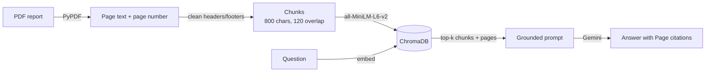

# 📊 Annual Report Q&A Assistant (RAG)

Ask plain-English questions about a company annual report and get short answers with **page-level citations**.
If the answer is not in the report, the assistant says so instead of guessing.

Built with **Python, LangChain, PyPDF, Sentence-Transformers, ChromaDB, Gemini API and Streamlit**.

> The sample document is a 28-page annual report for **Veltrix Technologies Limited**, a fictional IT company created for this project.
> Its financial statements tie out (P&L, balance sheet and cash flow), so answers can be checked precisely.
> You can also upload any other text-based PDF in the app.

---

## How it works



1. **Ingest** (`src/ingest.py`) – reads the PDF page by page with PyPDF, removes running headers/footers and page numbers, and splits each page into overlapping chunks. Chunks never cross a page boundary, so every chunk carries exactly one page number.
2. **Index** (`src/vectorstore.py`) – embeds chunks locally with `sentence-transformers/all-MiniLM-L6-v2` (no API cost) and stores them in ChromaDB with cosine similarity.
3. **Retrieve & answer** (`src/rag.py`) – fetches the top-k chunks for a question, labels each one with `[Page N]`, and sends them to Gemini with a strict prompt: answer only from the context, cite pages, and reply *"I could not find this information in the report."* when the answer is missing.
4. **App** (`app.py`) – Streamlit chat UI showing the answer, the source excerpts, their pages and relevance scores.
5. **Evaluation** (`evaluate.py`) – compares chunk sizes on retrieval quality and scores end-to-end answers on 18 test questions (15 answerable + 3 not in the report).

## Project structure

```
annual-report-rag/
├── app.py                     # Streamlit app
├── build_index.py             # Builds the ChromaDB index from the PDF
├── evaluate.py                # Chunk-size comparison + answer evaluation
├── data/
│   └── veltrix_annual_report_fy2026.pdf   # 28-page sample report
├── eval/
│   ├── questions.json         # 18 test questions with expected facts and pages
│   └── results/               # Created when you run evaluate.py
├── scripts/
│   └── generate_report.py     # Recreates the sample PDF (ReportLab)
├── src/
│   ├── config.py              # Settings (reads .env)
│   ├── ingest.py              # PDF loading, cleaning, chunking
│   ├── vectorstore.py         # Embeddings + ChromaDB
│   └── rag.py                 # Retrieval, prompt, Gemini call
├── tests/test_pipeline.py     # Fast tests (no model download, no API calls)
├── requirements.txt
└── .env.example
```

## Setup

Requires Python 3.10+ and a free Gemini API key from [Google AI Studio](https://aistudio.google.com/apikey).

```bash
git clone https://github.com/<your-username>/annual-report-rag.git
cd annual-report-rag

python -m venv .venv
# Windows: .venv\Scripts\activate     macOS/Linux: source .venv/bin/activate
pip install -r requirements.txt

cp .env.example .env          # Windows: copy .env.example .env
# then open .env and paste your GOOGLE_API_KEY
```

## Run

```bash
python build_index.py         # ~1 min the first time (downloads the 90 MB embedding model)
streamlit run app.py          # opens http://localhost:8501
```

Try questions like:

- What was the revenue from operations in FY2025-26?
- How much did the company pay to acquire DataHarbor Analytics?
- What revenue growth does management expect for FY2026-27?
- What target price have analysts set for the shares? *(not in the report → the assistant declines)*

## Evaluation

```bash
python evaluate.py --mode retrieval   # chunk-size comparison, no API key needed
python evaluate.py --mode answers     # full pipeline with Gemini (18 calls)
pytest -q                             # unit tests
```

**Retrieval** – for chunk sizes 300 / 500 / 800 / 1200 characters (15% overlap), checks whether a chunk from the correct page is in the top-4 results (Hit@4) and how high it ranks (MRR). Results are saved to `eval/results/chunk_size_comparison.csv`.

**Answers** – an answer counts as correct when it contains every expected fact (e.g. `4,820` for revenue) and does not refuse; for the 3 questions that are not in the report it is correct only when the model declines. It also checks whether the cited page is a correct page. Results go to `eval/results/answer_eval.csv` and `summary.txt`.

### Results

Fill this in from your own run (`eval/results/`):

| Chunk size | Chunks | Hit@4 | MRR |
|-----------:|-------:|------:|----:|
| 300  | | | |
| 500  | | | |
| 800  | | | |
| 1200 | | | |

| Metric | Result |
|---|---|
| Answerable questions answered correctly | _ / 15 |
| Answers citing a correct page | _ / 15 |
| Out-of-scope questions correctly declined | _ / 3 |

## Design decisions

- **Page-aware chunking** – splitting each page separately means a citation always points to one real page.
- **Header/footer removal** – lines repeated on most pages (the running footer) are dropped so they do not pollute embeddings. Bare numbers are removed only at the top or bottom of a page, because inside a page they are usually table values.
- **Local embeddings** – `all-MiniLM-L6-v2` runs on CPU, so indexing is free and data stays on your machine; only the retrieved excerpts are sent to Gemini.
- **Grounded prompt + temperature 0** – the model must cite pages and use a fixed refusal sentence, which also makes refusals easy to measure in evaluation.

## Limitations and next steps

- Scanned PDFs have no text layer; adding OCR (e.g. Tesseract) would handle them.
- Complex tables lose some structure in plain-text extraction; a table-aware parser would help with numeric questions.
- Possible improvements: hybrid search (BM25 + vectors), a cross-encoder re-ranker, and multi-document comparison across years.

## Configuration

All settings can be changed in `.env`: `GEMINI_MODEL`, `CHUNK_SIZE`, `CHUNK_OVERLAP`, `TOP_K`, `EMBEDDING_MODEL`, `PDF_PATH`.
If Google retires the default model, set `GEMINI_MODEL` to any current model ID listed in the [Gemini API docs](https://ai.google.dev/gemini-api/docs/models).

## License

MIT
